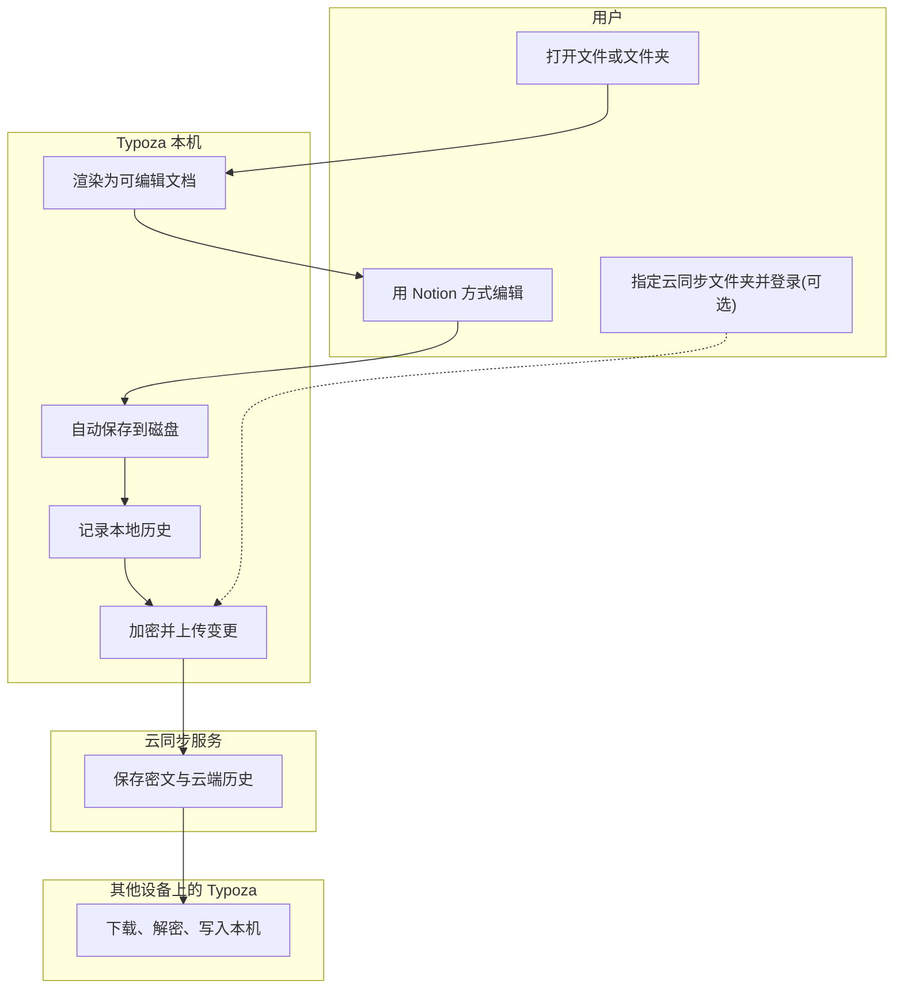
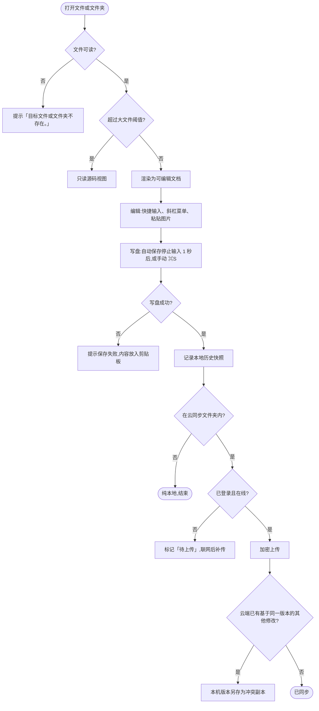

# Typoza 基础版

> 版本 v1.0 · 2026-10-16 · 产品
>
> 信息来源(均于 2026-10-16 核实):本机 Typora 1.9.4(`/Applications/Typora.app` 的菜单、偏好设置与内置文档);Typora 官方文档 https://support.typora.io/Shortcut-Keys/ 、https://support.typora.io/Export/ 、https://support.typora.io/Images/ 、https://support.typora.io/HTML/ 、https://support.typora.io/Math/ 、https://support.typora.io/Version-Control/ ;Notion 帮助中心 https://www.notion.com/help/keyboard-shortcuts 、https://www.notion.com/help/writing-and-editing-basics 、https://www.notion.com/help/images-files-and-media 、https://www.notion.com/help/embed-and-connect-other-apps 、https://www.notion.com/help/math-equations 。
>
> 逐项依据见同目录 `typora-parity.md`(Typora 功能对照表,即研发实现清单)与 `notion-input.md`(Notion 输入规范),本文只写决定性规则。

## 一、需求概述

日常用 Typora 浏览和编写 Markdown 的人,输入习惯与 Notion 不一致,截图混排文档里表格内、带链接的图片也无法放大查看。Typoza 基础版是 macOS 原生 Markdown 编辑器:完整覆盖 Typora 功能,输入方式与快捷键采用 Notion,加强图片灯箱、动图、音视频、在线嵌入、书签、PDF 与附件,纯本地即可完整使用,另有只负责保存的可选端到端加密云同步。多人协作与评论、数据库与看板、同步块、分栏、AI、网页版与 Windows / iOS 本期不做;涉及本机用户与云同步服务。

### 质量要求

| 指标 | 目标 | 口径 |
|---|---|---|
| 冷启动到可输入 | ≤1 秒 | 从点击应用图标到新文档光标可输入【待确认:基准机型】 |
| 打开 5MB Markdown | ≤1.5 秒 | 从发起打开到首屏渲染完成、可滚动 |
| 输入延迟 | p95 ≤16 毫秒 | 在 5MB 文档中连续输入,按键到字符上屏 |
| 安装包 | ≤30MB | DMG 文件体积 |
| 不丢内容 | 崩溃或强退后重启,恢复到最后一次自动保存的内容 | 自动保存在停止输入 1 秒后写盘【假设】 |
| 纯本地 | 未登录云同步时不发起同步相关网络请求 | 检查更新、书签取网页信息、在线嵌入除外,均由用户操作或可关闭 |

## 二、业务流程与状态

**业务流程图(总)**



**怎么看**:框是参与方,实线为主流程,虚线表示开启云同步后才有的环节。

**功能流程图(总)**



**云同步文件状态**(只针对云同步文件夹内的文件)

| 状态 | 进入条件 | 可做操作 | 去向 |
|---|---|---|---|
| 仅本地 | 文件不在云同步文件夹内,或未登录 | 编辑、移入云同步文件夹 | 移入同步文件夹且已登录 → 待上传 |
| 待上传 | 同步文件夹内文件有新保存;或离线、未登录 | 编辑 | 联网且已登录 → 同步中 |
| 同步中 | 开始上传或下载 | 编辑(新修改排在本次之后) | 成功 → 已同步;检测到冲突 → 生成冲突副本后两份各自进入待上传;失败 → 同步失败 |
| 已同步 | 本机与云端最新版本一致 | 编辑、查看云端历史 | 本机保存 → 待上传;云端有新版本 → 同步中 |
| 同步失败 | 空间不足、账号异常等非网络原因 | 查看原因、【重试】 | 重试成功 → 已同步 |
| 已删除 | 任一设备删除该文件 | 在云端回收站【恢复】、【永久删除】 | 恢复 → 同步中 → 已同步;满 30 天或永久删除 → 清除(终态) |

## 三、功能需求

### 3.1 文件与窗口

场景:用户打开单个 md 或整个文件夹浏览、编辑,多个文档用标签页或窗口并排。

| 需求点 | 说明 |
|---|---|
| 打开 | ⌘O、拖到程序坞图标、Finder 双击(设为默认应用后)均可打开;打开文件时其所在文件夹载入侧栏;同一文件已打开时切到已有标签,不重复打开 |
| 标签与窗口 | ⌘T 新标签、⇧⌘N 新窗口、⇧⌘T 重开最近关闭;⌘+点击本地 md 链接在新标签打开,⌥⇧+点击在新窗口打开 |
| 保存 | 自动保存默认开,停止输入 1 秒写盘;关闭自动保存后关窗询问「是否保存更改? 如果不保存,您的更改将会丢失。」;按原编码、原换行符写回;另存为 ⌥⇧⌘S |
| 未命名草稿 | 未保存的新文档自动备份到 Typoza 数据目录,重启后恢复到原标签;首次保存默认文件名取首个标题 |
| 外部修改 | 文件被其他程序修改:本机无未保存修改 → 静默重新加载;有未保存修改 → 提示「文件已被其他程序修改」,【重新加载】/【保留我的修改】【假设】 |
| 异常 | 文件不存在提示「目标文件或文件夹不存在。」;只读文件可浏览,输入时提示「该文件只读,修改无法保存」并给【另存为】;超过大文件阈值以只读源码打开【待确认:阈值由研发压测后定】 |

### 3.2 编辑器与块

场景:用户在所见即所得界面编辑,内容以块组织,存回 Markdown 后用别的编辑器打开不丢内容。

| 需求点 | 说明 |
|---|---|
| 块与存储 | 段落、标题 1~6、列表、待办、引用、折叠块、标注块、代码、公式、表格、分割线、目录、图片、媒体、嵌入、书签、附件、HTML、YAML 元数据;存储一律标准 Markdown 优先,其次通用 HTML 标签,逐项见对照表与输入规范 |
| 往返保真 | 打开后不编辑直接保存,文件逐字节不变;只改一处时其余内容(含不认识的语法、HTML、`[[链接]]`、`~下标~`)原样保留 |
| 标记显示 | 默认不显示 Markdown 标记;偏好开启「编辑时显示 Markdown 标记」后,光标进入行内样式与标题时展开源码 |
| 块操作 | 悬停显示「+」与「⋮⋮」;Esc 选中当前块;拖拽、复制、移动、删除、转换规则见输入规范第七节 |
| 链接 | 单击显示浮层【打开】【编辑】【复制】【移除】;⌘+点击直接打开(网址用浏览器、`#标题` 文内跳转、本地 md 新标签);目标文件不存在时询问「无法打开 X,是否在 Y 新建文件并继续?」;⌘[ 返回 |
| 字数 | 状态栏显示全文字数;有选区或选中块时显示所选部分;点击弹出词、字符、行与阅读时间 |

### 3.3 Notion 输入

场景:习惯 Notion 的用户用同样的快捷输入、斜杠菜单和快捷键写 Markdown。

| 需求点 | 说明 |
|---|---|
| 快捷输入 | 块开头 `#`、`-`、`[]`、`1.`、`>`、`"` 加空格及 `---` 即时转换;行内 `**`、`*`、`` ` ``、`~`、`$$` 闭合时转换;代码、公式、链接地址内不触发;全表见输入规范第二节 |
| 已拍板差异 | `>`+空格 = 折叠块(存 `<details><summary>`);`"`+空格 = 引用;⌘/ = 「转换为」菜单;打开已有 `>` 内容仍显示为引用 |
| 斜杠菜单 | 输入 `/` 打开,英文命令与中文名都可搜;Esc 关闭并保留已输入字符;条目全表见输入规范第四节 |
| 文档链接 | `[[` 或 `@` 选文档 → 插入 `[标题](相对路径.md)`;选「+ 新建」在当前文件夹新建同名 md;打开含 `[[文档名]]` 的文件照常识别并原样保留 |
| 快捷键 | Notion 键位优先;被挤占的 Typora 功能改到不冲突键位(源代码模式 ⌃⌘/、插入表格 ⌥⇧⌘T、侧边栏 ⌃⌘S、高亮 ⌃⌘H、另存为 ⌥⇧⌘S、打印 ⇧⌘P 等);全表与冲突处理见输入规范第五、六节 |
| 撤回 | 任何自动转换后立即 ⌘Z,撤回为输入的原字符且不再二次转换 |

### 3.4 图片与灯箱

场景:用户浏览标题、段落、表单截图、配置表格混排的文档,需要把任意一张图放大看清。

| 需求点 | 说明 |
|---|---|
| 生效范围 | 灯箱对全部图片生效:正文图片、表格单元格内图片、带链接的图片、HTML ``、动图、网络图片 |
| 单击 | 选中图片:显示四角尺寸手柄与浮动工具条(替代文字、缩放比例、转换语法、复制图片、在 Finder 中显示、替换、删除);带链接的图片单击不跳转,⌘+点击才打开链接 |
| 打开灯箱 | 双击图片,或选中后按空格、⌘↩ → 背景变暗,图片按窗口适配居中;灯箱打开期间编辑区不响应输入 |
| 灯箱内操作 | 滚轮或捏合缩放(10%~800%【假设】);拖动平移;双击在「适配窗口」与「100%」间切换;← / → 按文中顺序浏览本文全部图片,顶部显示「3 / 12」,首尾不循环;【旋转】每次 90°,只改显示不改文件;【复制图片】;【在 Finder 中显示】(网络图片为【在浏览器中打开】);Esc 或点暗处关闭 |
| 尺寸存储 | 拖手柄 → ``;菜单选比例 → `style="zoom:50%;"`;未改尺寸的图片保持 `` |
| 插入与失败 | 粘贴、拖入、插入本地图片默认复制到 ./assets 并写相对路径;目标文件夹不存在时询问「该目录不存在,是否立即创建?」;加载失败显示占位与原路径,灯箱内提示「图片无法加载」 |

### 3.5 媒体与嵌入

场景:用户在文档中放动图、视频、音频、在线内容、网页书签、PDF 和附件,在 Typoza 里直接查看。

| 需求点 | 说明 |
|---|---|
| 动图 | GIF、APNG、动态 WebP 自动播放;选中后工具条可【暂停】;存储同普通图片 |
| 视频与音频 | /video、/audio、拖入或粘贴媒体文件 → 复制到 ./assets → 存 `<video src="路径" controls>` / `<audio src="路径" controls>`;文内播放,视频可全屏;文件丢失显示「找不到媒体文件」与原路径 |
| 在线嵌入 | /embed 或粘贴网址后选【嵌入】→ 存 `<iframe src="网址">`;常见视频网站网址自动换成嵌入地址【待确认:首批站点清单】;嵌入内容隔离运行、读不到本地文件;离线或站点拒绝时显示「无法加载嵌入内容」与【在浏览器中打开】【改为书签】 |
| 书签卡片 | /bookmark 或粘贴网址后选【书签卡片】→ 取网页标题、描述、图标 → 存单独成段的 `[网页标题](网址 "网页描述")`;取不到时用网址作标题并提示「无法获取网页信息,已用网址作标题」 |
| PDF | /pdf 选本地 PDF 或网址 → 文内预览,可翻页、缩放;存 `<iframe src="路径.pdf">`【假设】;⌘↩ 用系统「预览」打开 |
| 附件 | /file 或拖入非图片、非媒体、不可导入的文件 → 复制到 ./assets → 存 `[文件名](assets/文件名)`;单独成段时显示附件卡片(图标、文件名、大小),点击用默认应用打开;docx 等可导入文件拖入时按偏好「导入」或「插入链接」 |

### 3.6 表格

场景:用户编辑配置表、对照表,单元格里有行内格式与截图。

| 需求点 | 说明 |
|---|---|
| 创建 | 输入 `\| 列1 \| 列2 \|` 后回车、/table(3 列 × 3 行)、⌥⇧⌘T(弹窗选行列);存 GFM 表格 |
| 编辑键 | Tab / ⇧Tab 在单元格间移动,末格 Tab 新增一行;⌘↩ 下方插入行;⇧⌘⌫ 删除行;⌃⌘方向键移动行列;拖行左边框、列上边框换位 |
| 工具条 | 光标进入表格时显示:调整行列数、左 / 中 / 右对齐(存 `:---` `:---:` `---:`)、删除表格、更多(插入行列、复制表格、格式化源码) |
| 单元格内容 | 支持行内格式、链接、图片(灯箱生效);⇧↩ 存 `<br>`;粘贴多段内容进单元格时合并为一格、段间存 `<br>` |
| 批量填充 | 选中多个单元格后 ⌘D 向下填充、⌘R 向右填充 |
| 不提供 | 合并单元格、保存列宽(GFM 无对应写法),不出现操作入口 |

### 3.7 代码、公式、图表

场景:技术文档作者写代码片段、数学公式和流程图。

| 需求点 | 说明 |
|---|---|
| 代码块 | `` ``` `` 后回车、⌥⌘C、⌥⌘8、/code 创建;右下角选语言并下拉补全,约 150 种语言高亮;右上角【复制】;行号、自动换行、缩进宽度按偏好 |
| 公式 | 块公式:`$$` 后回车、⌥⌘B、/math;行内公式:`$$公式$$` 闭合或 ⇧⌘E,存 `$公式$`;编辑时下方实时预览,离开即渲染;语法错误显示错误提示,源码不清空 |
| 公式选项 | 自动编号(不编号 / AMS 规则 / 全部编号)、physics 包、`\\` 换行、`\tag` `\label` `\ref`;右键复制为 TeX 或 MathML |
| 图表 | 代码块语言为 mermaid、sequence、flow 时渲染为图;点击进入源码编辑,离开后重新渲染;语法错误时显示错误信息并保留源码 |
| 导出 | PDF、HTML、图片导出包含渲染后的代码高亮、公式与图表;无样式 HTML 中公式按偏好输出 SVG 或 LaTeX 源码 |

### 3.8 侧栏(文件树 / 文档列表 / 大纲)

场景:用户把一个文件夹当作文档库浏览,在文件间跳转并整理文件。

| 需求点 | 说明 |
|---|---|
| 视图切换 | 文件树 ⌃⌘3、文档列表 ⌃⌘2、大纲 ⌃⌘1;⌃⌘S 显示 / 隐藏侧栏 |
| 文件树 | 只列可打开的文件与文件夹;新建、重命名、创建副本、移动、删除(移到废纸篓,提示「您可以从回收站恢复文件。」)、在 Finder 中显示、复制路径;拖动移动,拖进编辑区插入链接;随磁盘变化自动刷新 |
| 文档列表 | 显示文件名、首段摘要、修改时间;排序:自然、文件名、修改时间、创建时间各分升降序;可按文件夹分组;排序重启后保留 |
| 大纲 | 列出标题(含折叠标题),点击跳转;滚动时高亮当前章节;可折叠;无标题时显示「大纲内容为空」 |
| 同步标记 | 云同步文件夹内的文件在文件树上显示同步状态图标(状态见第二节状态表) |
| 改名联动 | 重命名或移动 md 后询问「是否更新其他文档中指向它的 N 处链接?」【更新】/【不更新】【假设】 |

### 3.9 搜索与快速打开

场景:用户在当前文档或整个文件夹里找内容,或凭名字快速打开文件。

| 需求点 | 说明 |
|---|---|
| 文内查找 | ⌘F 打开查找栏;可选「区分大小写」「查找整个单词」「正则表达式」;⌘G / ⇧⌘G 跳转;无结果提示「未找到所查内容」 |
| 替换 | ⌥⌘F 打开替换栏;【替换】【全部替换】,可限选中范围;全部替换可一次 ⌘Z 撤回 |
| 全局搜索 | ⇧⌘F 在侧栏搜索当前根文件夹内全部可打开文件的文件名与正文;按文件分组显示命中片段,点击打开并定位;命中超过 1000 处提示「匹配结果过多」【假设:上限】 |
| 快速打开 | ⌘P(另 ⇧⌘O)弹出输入框,按文件名与首个标题模糊匹配当前根文件夹及最近文件;↩ 在当前标签打开,⌘↩ 在新标签打开【假设】;无结果提示「没有找到对应的内容」 |
| 索引 | 后台建立文件名与正文索引,不阻塞打开与输入;建立期间结果末尾显示「正在加载更多结果」 |

### 3.10 视图模式(源码 / 专注 / 打字机)

场景:用户需要直接改 Markdown 源码,或在长文写作时减少干扰。

| 需求点 | 说明 |
|---|---|
| 源代码模式 | ⌃⌘/ 切换;整篇显示 Markdown 源码并着色;来回切换保持光标所在位置;源码模式下粘贴一律为纯文本 |
| 专注模式 | F8 切换;只突出光标所在块,其余变淡 |
| 打字机模式 | F9 切换;光标所在行保持在窗口中部;偏好可改为只在输入时保持居中 |
| 叠加与保留 | 专注与打字机可同时开;开关对所有文档生效,重启后保留;偏好【关闭打字机 / 专注模式】一键关闭并提示「打字机模式 / 专注模式 已被关闭。」 |

### 3.11 主题与外观

场景:用户按喜好或光线环境调整文档外观。

| 需求点 | 说明 |
|---|---|
| 内置主题 | Github、Gothic、Newsprint、Night、Pixyll、Whitey 6 款,默认 Github【假设】 |
| 深浅色 | 默认跟随系统,可为深色模式单独选主题;⇧⌘L 手动切换浅色 / 深色并记住选择 |
| 自定义主题 | 主题文件夹放入 css 即出现在主题菜单,无需重启;base.user.css、主题名.user.css 追加样式;第三方 Typora 主题保证正文、标题、代码块、表格、引用的样式生效 |
| 字号与缩放 | 字号跟随主题或自定义;⌘+ / ⌘- / ⇧⌘0 缩放页面;按住 ⌘ 滚动滚轮缩放 |
| 状态栏 | 显示字数、源代码模式开关、同步状态;可在显示菜单隐藏 |

### 3.12 导出与打印

场景:用户把文档交给不用 Markdown 的人,或归档为 PDF。

| 需求点 | 说明 |
|---|---|
| 内置格式 | PDF、HTML、HTML(无样式)、图片,无需额外软件 |
| Pandoc 格式 | Word、OpenOffice、RTF、Epub、LaTeX、Media Wiki、reStructuredText、Textile、OPML 等调用用户已装的 Pandoc;导入同样走 Pandoc;未检测到时提示「需要安装 Pandoc 以继续…」并给【安装说明】 |
| 导出设置 | 默认文件夹、导出后动作、各格式参数、从模板新增导出项;允许文档 YAML 覆盖导出参数 |
| 重复导出 | 【使用上一次设置导出】;【导出并覆盖上一次导出的文件】先确认「会覆盖位于 路径 的文件,是否继续?」 |
| 打印 | ⇧⌘P 打开系统打印;深色主题时自动改用浅色主题打印 |
| 结果反馈 | 成功提示「导出成功」并按设置打开文件或所在文件夹;失败提示「导出失败:」+ 原因 |

### 3.13 偏好设置

场景:用户调整 Typoza 的默认行为,或从 Typora 迁移时找回熟悉的选项。

| 需求点 | 说明 |
|---|---|
| 分页 | 文件、编辑器、图像、Markdown、导出、外观、通用,选项与 Typora 对齐(对照表 PF~PG 行);另增「快捷键」「云同步」两页 |
| 生效 | 所有选项改完立即生效,无需重启 |
| 快捷键页 | 列出全部命令与当前键位,可搜索;点击录制新键位;与已有键位或系统保留键冲突时就地提示「该键位已被『命令名』使用」,确认后原命令改为无键位;【恢复默认】 |
| 与 Typora 默认不同 | 插入图片默认复制到 ./assets;自动保存默认开;Markdown 标记默认不显示;匹配 Markdown 字符默认关 |
| 不提供 | 许可证激活、调试模式、匿名使用统计、Typora 国内服务器、窗口样式三选一、Windows 系统集成 |

### 3.14 本地历史版本

场景:用户误改、误删内容后找回旧版本。

| 需求点 | 说明 |
|---|---|
| 生成 | 每次写盘后记一个快照,5 分钟内的连续自动保存合并为 1 个【假设】;快照存 Typoza 数据目录,不写进文档所在文件夹 |
| 保留 | 每个文件最多 50 个、最长 90 天,超出删最旧【假设:与云端口径一致】 |
| 查看 | 文件菜单【浏览所有版本】打开历史面板:左侧按时间列出,右侧预览并标出与当前内容的差异 |
| 恢复 | 选中版本点【恢复此版本】→ 先把当前内容记为快照,再替换为所选版本,提示「已恢复到 2026-10-16 14:30 的版本」;也可【复制内容】只取片段 |
| 改名与删除 | 在 Typoza 内重命名或移动后历史跟随;文件删除后历史保留到期满,可在面板「已删除的文件」中找回 |
| 同步文件夹 | 云同步文件夹内的文件在面板中分「本机」「云端」两栏,云端历史规则见 3.16 |

### 3.15 云同步账号

场景:用户在多台 Mac 上用同一批文档,开启可选的端到端加密云同步。

| 需求点 | 说明 |
|---|---|
| 入口 | 偏好「云同步」页【创建账号】/【登录】;未登录时不发起任何同步请求 |
| 创建账号 | 邮箱 + 主密码(两次输入一致,至少 10 位【假设】)→ 邮箱验证 → 整页显示恢复码一次,勾选「我已妥善保存恢复码」才能继续;页面提示「恢复码只显示这一次。忘记主密码且丢失恢复码,你的数据将无法解密」 |
| 登录 | 邮箱 + 主密码;已开两步验证再输 6 位验证码;错误统一提示「邮箱或主密码错误」;连续 5 次失败锁定 15 分钟【假设】 |
| 两步验证 | 可选开启:用验证器应用扫码绑定,输入 6 位码确认;关闭时需输入主密码与当前验证码 |
| 主密码 | 修改需先输旧主密码;忘记主密码只能用恢复码重设,提示「Typoza 无法替你找回主密码」;修改或重设后其他设备需重新登录 |
| 云同步文件夹 | 只有用户指定的文件夹上云,文件夹外的文件永不上传【待确认:是否允许多个】;退出登录时询问【保留本机文件】(默认)/【同时删除本机副本】 |

### 3.16 云同步冲突与回收站

场景:同一文件在两台设备上被修改,或用户误删同步文件夹里的文件。

| 需求点 | 说明 |
|---|---|
| 同步时机 | 同步文件夹内文件保存后自动上传;启动、联网恢复、窗口回到前台时拉取更新;上传前在本机加密,服务端只存密文 |
| 冲突处理 | 两台设备基于同一版本各自修改 → 后上传方检测到冲突:云端版本写入原文件,本机版本另存为同文件夹下「文件名(冲突副本 设备名 2026-10-16 14-30).md」;提示「发现修改冲突,你的版本已另存为冲突副本」带【并排对比】;任何情况下不静默覆盖 |
| 云端历史 | 每个文件保留 50 个版本、最长 90 天,超出删最旧;在历史面板「云端」栏预览与恢复,恢复生成新版本、不删除旧历史 |
| 删除与回收站 | 同步文件夹内删除文件 → 其他设备同步删除,云端进回收站保留 30 天;偏好「云同步」页【回收站】可预览、【恢复】(回原路径,同名时文件名加「(已恢复)」)、【永久删除】(二次确认「永久删除后无法恢复,确定删除?」) |
| 离线与失败 | 离线时照常编辑保存,状态「待上传」,联网后自动补传;空间不足等失败在状态栏显示「同步失败:原因」与【重试】 |
