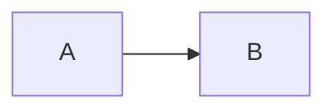

# Markdown 参考

Typoza 的文件就是普通的 Markdown 文本。下面列出常用写法,以及 Typoza 新增内容在文件里是怎么存的——用别的编辑器打开也能看懂、不丢内容。

## 段落与标题

- 空一行开始新段落;段内换行按 `⇧↩`,存成行尾的反斜杠 `\`
- 标题:`# 一级标题` 到 `###### 六级标题`;在 Typoza 里输入 `#` 加空格立即变成标题

## 行内样式

| 效果 | 写法 | 快捷键 |
| --- | --- | --- |
| 加粗 | `**文字**` | `⌘B` |
| 斜体 | `*文字*` | `⌘I` |
| 删除线 | `~~文字~~` | `⇧⌘S` |
| 下划线 | `<u>文字</u>` | `⌘U` |
| 行内代码 | `` `代码` `` | `⌘E` |
| 高亮 | `==文字==` | `⌃⌘H` |
| 文字颜色 | `<span style="color: #D44C47">文字</span>` | 选中文字后在格式条里选 |
| 行内公式 | `$E=mc^2$` | `⇧⌘E` |

上标 `^文字^`、下标 `~文字~` 默认不识别(避免与删除线冲突),可在偏好设置里打开。

## 链接

- 网址:`[文字](https://example.com)`,正文里的裸网址自动成链接
- 文档:`[文字](笔记/另一篇.md)`,相对当前文档;`.md` 可以省略;跳到标题写 `[文字](另一篇.md#标题)`
- 文内标题:`[文字](#标题)`;也可以用 `<a id="名字"></a>` 放一个命名锚点
- 引用式:`[文字][id]`,另起一行写 `[id]: https://example.com`
- 文档之间的关联也认 `[[另一篇]]`、`[[另一篇|别名]]`,保存时原样保留

单击链接显示【打开】【编辑】【复制】【移除】;`⌘` + 点击直接打开(本地文档在新标签页),`⌥⇧` + 点击在新窗口打开;`⌘[` 返回。

## 列表与待办

```
- 无序列表
1. 有序列表
- [ ] 待办
- [x] 已完成
```

## 引用、提示块与折叠块

```
> 普通引用

> [!TIP]
> 提示块,另有 NOTE、IMPORTANT、WARNING、CAUTION

<details>
<summary>折叠标题</summary>

折叠内容

</details>
```

提示块用的是 GitHub 的写法;折叠块是标准 HTML,网页和 GitHub 上都能展开。

## 代码、公式与图表

````
```js
const a = 1
```

$$
\int_0^1 x\,dx
$$


````

## 表格

```
| 左对齐 | 居中 | 右对齐 |
| :-- | :-: | --: |
| a | b | c |
```

单元格里换行存成 `<br>`。

## 图片与媒体

| 内容 | 文件里的写法 |
| --- | --- |
| 图片 | ``;调整过大小的图片写成 `` 标签 |
| 视频 | `<video src="assets/演示.mp4" controls></video>` |
| 音频 | `<audio src="assets/录音.m4a" controls></audio>` |
| 在线嵌入、PDF | `<iframe src="网址或文件路径"></iframe>` |
| 书签卡片 | `<a href="网址" data-tz-type="bookmark">网页标题</a>` |
| 附件 | `<a href="assets/文件名" data-tz-type="file">文件名</a>` |

插入、粘贴、拖入的文件默认拷进文档旁的 `assets` 文件夹,文件里写相对路径。

## 其它

- 目录:单独一行写 `[TOC]`
- 脚注:正文写 `[^1]`,另起一行写 `[^1]: 脚注内容`
- 分割线:`---`
- 表情:直接存表情字符;已有的 `:smile:` 写法照常显示并原样保留
- 页面图标与封面:存在文件开头的 YAML 里

```
---
icon: 📘
cover: assets/封面.png
---
```

- 注释:`<!-- 注释 -->`
